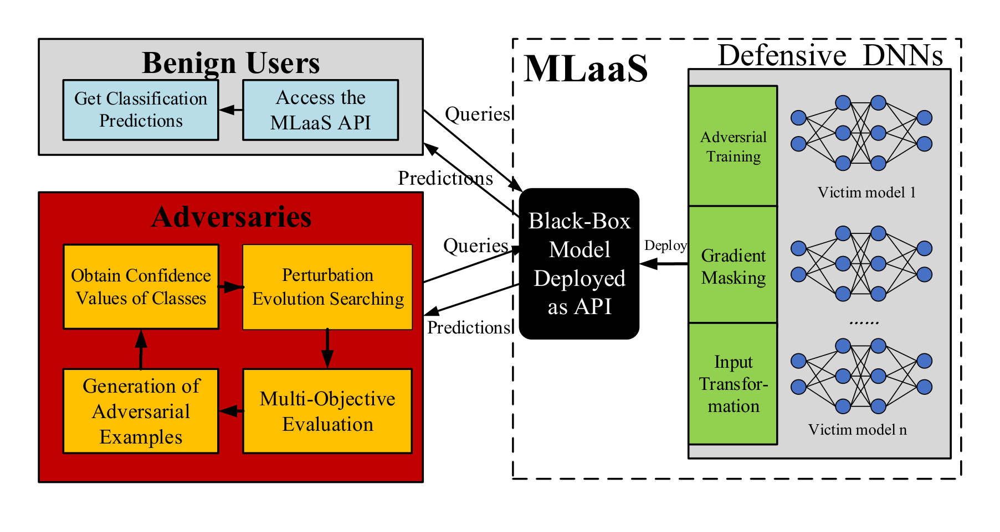
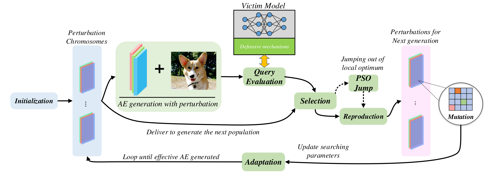
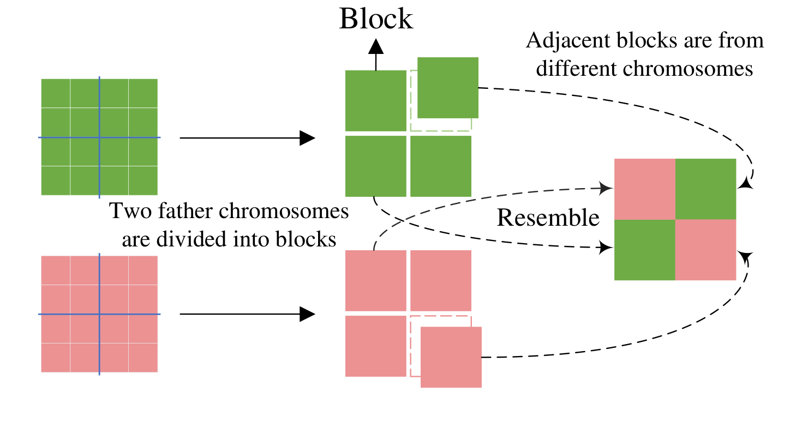
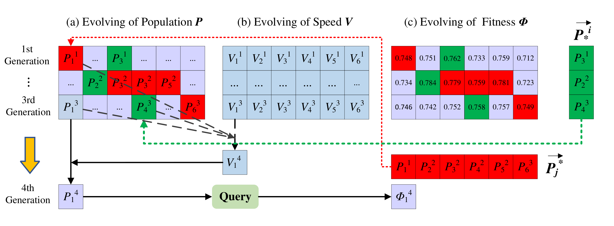
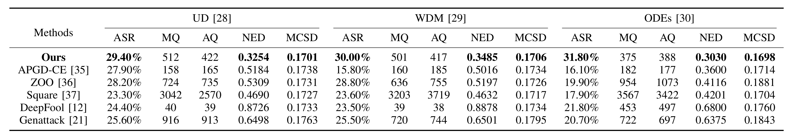

# QGD: Query-Efficient Generation of Adversarial Examples for Defensive DNNs

Official implementation of

> **Query-Efficient Generation of Adversarial Examples for Defensive DNNs via Multiobjective Optimization**
> Wei Jiang, Shen You, Jinyu Zhan, Xupeng Wang, Hong Lei, Deepak Adhikari
> *IEEE Transactions on Evolutionary Computation*, vol. 27, no. 4, pp. 832–847, Aug. 2023
> DOI: [10.1109/TEVC.2022.3231460](https://doi.org/10.1109/TEVC.2022.3231460) · [IEEE Xplore](https://ieeexplore.ieee.org/document/9997094/)

`QGD` is the name of this release; the framework is called **GAQA** in the paper.
The repository contains one attack interface and nothing else: give it a batch of
images and it returns the adversarial examples together with the query cost.

<p align="center">
  
</p>

<p align="center"><em>
Fig. 1. Black-box attacks on defensive DNNs in MLaaS. The adversary only sees the
confidence values returned by the API, and the victim may deploy adversarial
training, gradient masking or input transformation.
</em></p>

## The problem it solves

A deployed classifier is a query interface: you send an image, it returns the
confidence of every class. You do not get gradients, and you do not know the
architecture, the weights, or whether the service pre-processes your input. On
top of that, the model may be defended: adversarially trained, gradient-masked,
or wrapped in an input-transformation filter that squeezes or compresses the
image before classification.

GAQA generates adversarial examples in exactly this setting. The generation is
written as a constrained multi-objective problem with three objectives:

* **Attack effectiveness** — the adversarial image is misclassified with high
  confidence (Eq. 2).
* **Attack evasiveness** — the perturbation stays small in L2 and keeps enough
  high-frequency energy to survive input transformation. The second part is
  measured by **MCSD**, the mean standard deviation of a pixel and its eight
  neighbours (Eq. 3–4).
* **Attack coverage** — the adversarial examples overlap with the ones found by
  other attacks (Eq. 5). This objective cannot be optimised inside the search,
  because it is defined between attack methods; it is measured after the fact.

Effectiveness and evasiveness are combined with a priority rule: evasiveness only
starts to matter once the example is adversarial. That gives the fitness of
Eq. 6,

```
Phi = min[1 + max_{t != y}(F(x_adv)_t - F(x_adv)_y), 1 + psi]
      + psi/2 * [(1 - ||x_adv - x||_2 / sqrt(dim(x) * eps^2)) + (1 - MCSD(x_adv) / MCSD_max)]
```

whose maximum is `1 + 2 * psi`. An adversarial example reaches `1 + psi`; a failed
one stays below it. The search therefore has a single scalar to rank candidates
while still preferring smooth, natural-looking perturbations among the successful
ones.

## Pipeline

<p align="center">
  
</p>

<p align="center"><em>
Fig. 2. Attack framework of GAQA. Perturbation chromosomes are queried against
the victim, selected by fitness, reproduced by three operators, optionally
jumped out of a local optimum, mutated and finally re-parameterised.
</em></p>

An iteration is nine steps (Algorithm 1):

1. **Initialisation** — the population of `Q` perturbation chromosomes is spread
   over `[-eps, eps]`.
2. **Query evaluation** — every chromosome is added to the clean image, clipped
   to `[0, 1]`, and sent to the victim; the returned confidences give the
   fitness of Eq. 6.
3. **Selection** — elites-preferred probabilistic selection, Eq. 8. The best
   chromosome always survives, the `i`-th one survives with probability
   `(n / (n + i - 1))^pi`.
4. **PSO-Jump** — if the predicted number of remaining iterations exceeds the
   threshold `Theta`, a short PSO run re-positions the population (Algorithm 2).
5. **Perturbation-varied reproduction** — `rho` children are placed along the
   direction the elite moved in the previous generation, `P_1^i + alpha * Delta`,
   each with a different `alpha`.
6. **Block-based crossover** — the top `eta` fathers are cut into square blocks
   and reassembled, `eta * (eta - 1)` children.
7. **Shuffle-based crossover** — an elite is mixed gene by gene with an inferior,
   Eq. 9.
8. **Discrete mutation** — each gene is replaced, with a small probability, by one
   of `gamma` quantised values in `[-eps, eps]`, Eq. 10–11.
9. **Adaptation** — the predicted remaining iterations `beta` of Eq. 12 drives
   `gamma` (Eq. 13), `eta` (Eq. 14) and the mutation/shuffling probabilities
   (Eq. 15).

<p align="center">
  
</p>

<p align="center"><em>
Fig. 3. Block-based crossover. Two father chromosomes are split into blocks and
reassembled so that adjacent blocks come from different fathers.
</em></p>

The PSO-Jump is what keeps the search from freezing: instead of restarting from
random perturbations (which throws the search effort away), the selected
population becomes a particle swarm for `U` steps, with `C1` and `C2` balancing
the pull towards the personal and the swarm best.

<p align="center">
  
</p>

<p align="center"><em>
Fig. 4. PSO-based perturbation evolution: positions, speeds and fitness over
generations, and how the 4th generation is produced from the 3rd.
</em></p>

## Results reported in the paper

On defensive models built on CIFAR-10, GAQA reaches the highest attack success
rate while staying cheaper than the black-box candidates, whose median query
counts run into the thousands:

<p align="center">
  
</p>

<p align="center"><em>
Table III. Attack comparison of defensive models on CIFAR-10 (UD, WDM and ODEs
defences), with ASR, median queries (MQ), average queries (AQ), normalised
Euclidean distance (NED) and MCSD.
</em></p>

Across the three benchmarks the paper reports a 100% attack success rate with an
average of 52.95% fewer queries than existing black-box attacks on non-defensive
models, and a query reduction of up to 70.92% on defensive models.

## Install

The release is managed with [uv](https://docs.astral.sh/uv/); `uv.lock` pins the
exact set of packages that was verified.

```bash
git clone https://github.com/youshengithub/QGD-CODE.git
cd QGD-CODE
uv sync
```

`pyproject.toml` points `torch` and `torchvision` at the CUDA 12.6 wheel index.
On a CPU-only machine, delete the `[[tool.uv.index]]` block and the
`[tool.uv.sources]` table, then run `uv sync` again.

## Quick start

The paper's victim models are WideResNet-based defended checkpoints that are not
redistributed here. `prepare_victim.py` trains a plain CIFAR classifier in about
fifteen minutes so the repository is runnable end to end; any other checkpoint of
the same architecture works just as well.

```bash
# 1. a victim to attack (CIFAR-10, ResNet-18, ~87% test accuracy, about 15 min)
uv run python prepare_victim.py --data cifar10 --arch resnet18 --epochs 60

# 2. attack a batch of 10 test images with the paper's settings
uv run python attack.py --model victim_cifar10.pt --num-images 10
```

`attack.py` writes `results/run/results.csv` (one row per image) and
`results/run/summary.json` (ASR, median and average queries, NED, MCSD).

A smaller run, useful while debugging:

```bash
uv run python attack.py --model victim_cifar10.pt --num-images 3 \
    --iters 300 --population 50 --output results/quick
```

## The interface

`attack.py` is the only entry point.

| Argument | Default | Meaning |
| --- | --- | --- |
| `--data` | `cifar10` | `cifar10` or `cifar100`, downloaded on first use |
| `--model` / `--arch` | `victim_cifar10.pt` / `resnet18` | Any torchvision classifier checkpoint |
| `--num-images` / `--start` | `10` / `0` | Which slice of the test set to attack |
| `--eps` | `8/255` | Perturbation bound (4/255 on ImageNet in the paper) |
| `--iters` | `1000` | Iteration budget `N` |
| `--population` | `100` | Population size `Q` |
| `--rho` | `10` | Perturbation-varied children |
| `--nu` | `300` | Extra iterations after the first successful AE |
| `--theta` | `1000` | PSO-Jump threshold `Theta` |
| `--psi` | `0.1` | Minimal attack effectiveness `psi` of Eq. 6 |
| `--selection-pi` | `8` | Selection exponent `pi` of Eq. 8 |
| `--pso-iters` / `--pso-particles` | `20` / `10` | `U` and `W` of Algorithm 2 |
| `--c1` / `--c2` | `0.5` | PSO coefficients of Eq. 17 |
| `--ablate` | – | Switch off `init`, `selection`, `pso`, `var`, `block`, `shuffle` or `mutation` (Table II) |
| `--output` | `results/run` | Output directory |

The defaults are the CIFAR-10 column of Table I.

## Hyperparameters

| Parameter | CIFAR-10 | CIFAR-100 | ImageNet |
| --- | --- | --- | --- |
| `Theta` (jump threshold) | 1000 | 1000 | 800 |
| `N` (iterations) | 1000 | 1000 | 800 |
| `Q` (population) | 100 | 100 | 40 |
| `rho` (varied children) | 10 | 10 | 5 |
| `C1`, `C2` | 0.5 | 0.5 | 0.5 |
| `U` (PSO steps) | 20 | 20 | 15 |
| `W` (PSO particles) | 10 | 10 | 5 |
| `nu` (extra iterations) | 300 | 300 | 300 |

## Verified run

<!-- RUN_LOG_START -->
Verified on 1 × RTX 4090 D with `uv` 0.13.10 and `torch 2.14.1+cu126`, on the
first 5 test images of CIFAR-10 with the paper's CIFAR-10 settings (`N = 1000`,
`Q = 100`, `rho = 10`, `Theta = 1000`, `nu = 300`, `U = 20`, `W = 10`,
`eps = 8/255`):

| | |
| --- | --- |
| Victim | ResNet-18, 87.18% clean accuracy (`prepare_victim.py`, 60 epochs) |
| Images attacked | 4 of the first 5 — image 3 is skipped because the victim already gets it wrong |
| ASR | **100%** (4/4) |
| MQ / AQ | **1400 / 1550** queries until the first AE |
| Total queries | 31 457 / 31 634 (median / average), including the 300 evasiveness iterations |
| NED / MCSD | 0.4764 / 0.0134 |
| Wall clock | about 13 s per image |

```
[    0] SUCCESS queries=   200/ 30318 iters=  302 ned=0.4260 mcsd=0.0120 (12s)
[    1] SUCCESS queries=  1000/ 31012 iters=  310 ned=0.5241 mcsd=0.0147 (12s)
[    2] SUCCESS queries=  1800/ 31902 iters=  318 ned=0.4783 mcsd=0.0133 (14s)
[    3] skipped: the victim already predicts 8 instead of 0
[    4] SUCCESS queries=  3200/ 33302 iters=  332 ned=0.4774 mcsd=0.0134 (13s)
```

The smaller configuration from the quick start (`--iters 300 --population 50`,
3 images) also reaches 100%, with MQ = 900 and 15 986 total queries.

Three things these numbers do not show. The victim is a plain ResNet-18, not one
of the defended WideResNet models of the paper, so this is evidence that the
implementation runs and attacks, not that it reproduces Table III. The query cost
is dominated by the mandatory `nu = 300` evasiveness iterations (300 × 100 =
30 000); the attack itself needs 200–3200 queries on this victim. And NED stays
near 0.48 because the evasiveness objective is only optimised after the first
successful AE, where the population already sits at near-maximal perturbations —
the paper reports NED 0.30–0.33 for the same algorithm, on its own victims.
<!-- RUN_LOG_END -->

## Notes on the equations

A release that claims to implement a paper should say where it had to make a
choice. Five places were not fully determined by the text:

* **`psi`.** The paper fixes neither `psi` nor `MCSD_max`. `psi` is the
  effectiveness above which the fitness stops rewarding confidence and starts
  rewarding evasiveness: the first term of Eq. 6 is `min(1 + margin, 1 + psi)`,
  so the priority rule only activates when a real margin can reach it. Since
  `margin = p_t - p_y <= 1 - p_y`, a `psi` close to 1 is unreachable and the rule
  silently stops working; we use `psi = 0.1`, i.e. the adversarial class has to
  lead by ten percentage points. `MCSD_max` is the MCSD of the checkerboard
  perturbation at the bound, the highest-frequency pattern that still fits in
  `[-eps, eps]`.
* **Success test.** Algorithm 1, line 10 tests `Phi > 1`, and Section IV-G reads
  that as "an effective AE has been generated". With Eq. 6 the test is not
  equivalent to a misclassification: the always-positive evasiveness term can
  lift a failed solution above 1, while a successful one with a small margin
  stays below `1 + psi`. The code therefore takes the label returned by the
  victim (`argmax != y`) as the success signal -- which is what ASR measures
  anyway -- and uses `Phi` for ranking only.
* **MQ / AQ.** The query counts in Table III (a few hundred on CIFAR-10) are only
  consistent with the queries spent up to the first effective AE, not with the
  `nu = 300` evasiveness iterations that follow it. `attack.py` reports both:
  `median_queries` / `average_queries` for the first AE, and the `*_total`
  variants including the refinement.
* **Discrete mutation.** Eq. 10 is realised as a uniform draw from the `gamma`
  equally spaced values in `[-eps, eps]` (`gamma = 3` gives `-eps, 0, +eps`), as
  described in the text of Section IV-E4.
* **Initial population.** Eq. 7 describes a ladder from `[-eps]^dim` to
  `[eps]^dim`. The per-element step `L = 2 * eps * dim(x) / n` is far larger than
  the bound itself, so the ladder saturates after one step and every member
  becomes a random corner of the box. The population is therefore drawn
  uniformly in `[-eps, eps]`; `--ablate init` gives the degenerate variant that
  starts from zero and relies on mutation alone, which is the ablation reported
  in Table II.

Every generation re-queries the whole population, so one iteration costs exactly
`Q` queries.

## Citation

```bibtex
@article{jiang2023query,
  title   = {Query-Efficient Generation of Adversarial Examples for Defensive
             DNNs via Multiobjective Optimization},
  author  = {Jiang, Wei and You, Shen and Zhan, Jinyu and Wang, Xupeng and
             Lei, Hong and Adhikari, Deepak},
  journal = {IEEE Transactions on Evolutionary Computation},
  volume  = {27},
  number  = {4},
  pages   = {832--847},
  year    = {2023},
  doi     = {10.1109/TEVC.2022.3231460}
}
```

## License

MIT, see [LICENSE](LICENSE).
