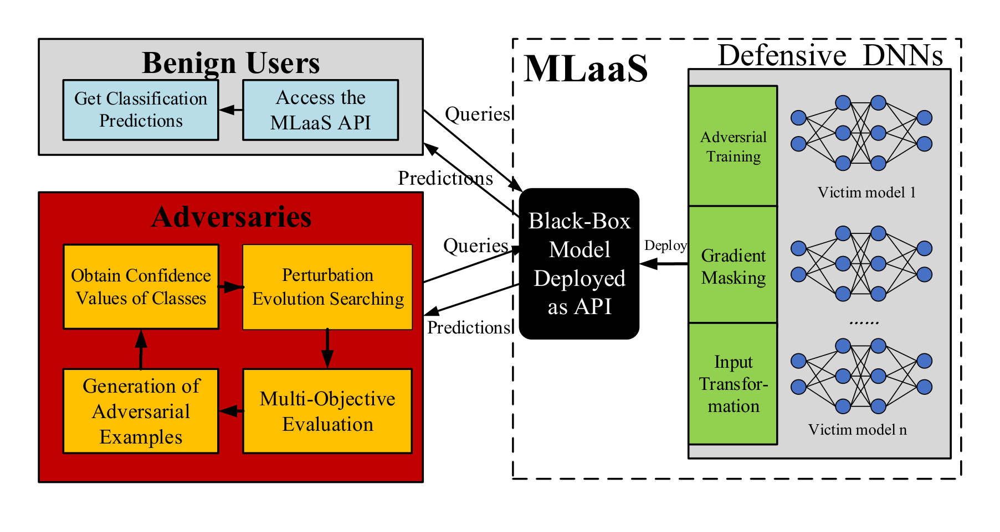
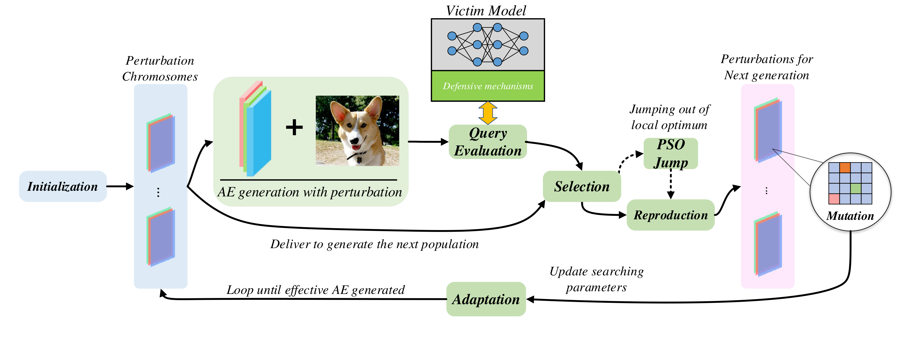
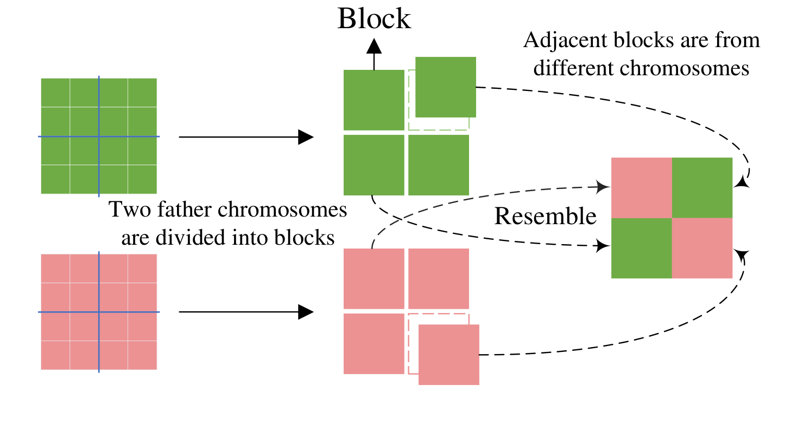
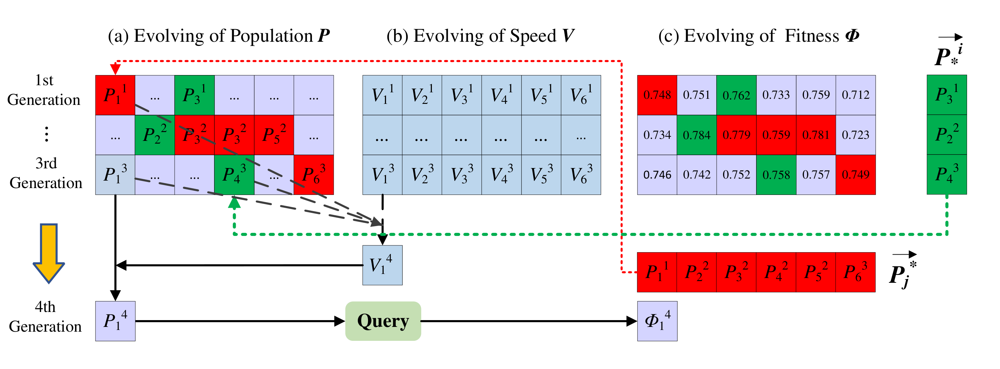
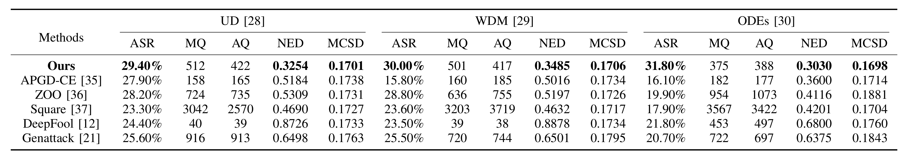

# QGD：面向防御型 DNN 的高查询效率对抗样本生成

本仓库是以下论文的官方实现：

> **Query-Efficient Generation of Adversarial Examples for Defensive DNNs via Multiobjective Optimization**
> Wei Jiang, Shen You, Jinyu Zhan, Xupeng Wang, Hong Lei, Deepak Adhikari
> *IEEE Transactions on Evolutionary Computation*, vol. 27, no. 4, pp. 832–847, Aug. 2023
> DOI: [10.1109/TEVC.2022.3231460](https://doi.org/10.1109/TEVC.2022.3231460) · [IEEE Xplore](https://ieeexplore.ieee.org/document/9997094/)

`QGD` 是本代码发布版的名称，论文里把这个框架称为 **GAQA**。
仓库只保留一个攻击接口：给一批图像，返回对抗样本和查询开销。

<p align="center">
  
</p>

<p align="center"><em>
图 1　MLaaS 场景下的黑盒攻击。攻击者只能看到 API 返回的置信度，而被攻击模型可能已经做了
对抗训练、梯度掩蔽或输入变换。
</em></p>

## 要解决的问题

部署在服务里的分类器就是一个查询接口：你交一张图，它返回每个类的置信度。你拿不到梯度，也不知道
模型结构、权重，更不知道服务端有没有先做预处理。更麻烦的是模型可能带防御：对抗训练、梯度掩蔽，
或者在外面套一层输入变换（squeeze、压缩）把扰动滤掉。

GAQA 就是在这个设定下生成对抗样本的。它把生成过程写成一个带约束的多目标问题，包含三个目标：

* **攻击有效性（effectiveness）**——对抗样本被高置信度地误分类（式 2）。
* **攻击回避性（evasiveness）**——扰动在 L2 上足够小，同时保留足够的高频能量以穿过输入变换。
  后半部分用 **MCSD** 度量，即每个像素与八邻域的标准差再取均值（式 3–4）。
* **攻击覆盖率（coverage）**——本方法找到的对抗样本与其他方法的重合程度（式 5）。这个目标定义在
  方法与方法之间，无法写进单次搜索的目标函数，因此在实验阶段度量。

有效性与回避性之间有一条优先级规则：只有攻击成功之后，回避性才值得优化。这给出式 6 的适应度

```
Phi = min[1 + max_{t != y}(F(x_adv)_t - F(x_adv)_y), 1 + psi]
      + psi/2 * [(1 - ||x_adv - x||_2 / sqrt(dim(x) * eps^2)) + (1 - MCSD(x_adv) / MCSD_max)]
```

最大值为 `1 + 2 * psi`。攻击成功的解恰好达到 `1 + psi`，失败的解低于它。于是搜索只需要一个标量就能
给候选解排序，而在成功解内部又会优先挑选扰动更小、更平滑的那些。

## 整体流程

<p align="center">
  
</p>

<p align="center"><em>
图 2　GAQA 的攻击框架。扰动染色体先查询受害模型，再按适应度选择、经三个算子繁殖、必要时跳出
局部最优、变异，最后更新搜索参数。
</em></p>

一次迭代分九步（算法 1）：

1. **初始化**——`Q` 个扰动染色体铺在 `[-eps, eps]` 上。
2. **查询评估**——每个染色体加到干净图像上，裁剪到 `[0, 1]`，送进受害模型；返回的置信度按式 6
   算出适应度。
3. **选择**——精英优先的概率选择，式 8。最优个体必定保留，第 `i` 个个体以
   `(n / (n + i - 1))^pi` 的概率保留。
4. **PSO 跳变**——当预测的剩余迭代次数超过阈值 `Theta`，用一小段 PSO 重新布置种群（算法 2）。
5. **扰动方向复制**——沿精英上一代的移动方向 `P_1^i + alpha * Delta` 生成 `rho` 个子代，
   每个子代用不同的 `alpha`。
6. **块交叉**——把前 `eta` 个父代切成方块再拼装，产生 `eta * (eta - 1)` 个子代。
7. **洗牌交叉**——精英与劣质个体逐基因混合，式 9。
8. **离散变异**——每个基因以较小概率被替换成 `[-eps, eps]` 内 `gamma` 个量化值之一，式 10–11。
9. **参数自适应**——用式 12 预测的剩余迭代 `beta` 更新 `gamma`（式 13）、`eta`（式 14）以及变异
   与洗牌概率（式 15）。

<p align="center">
  
</p>

<p align="center"><em>
图 3　块交叉算子。两个父代染色体被切成方块后重新拼装，相邻块来自不同父代。
</em></p>

PSO 跳变的作用是不让搜索僵住：与其丢掉扰动重新随机开始（那样前面的查询全白费），不如把选择后的
种群直接当作粒子群跑 `U` 步，用 `C1`、`C2` 平衡向个体最优与群体最优的牵引。

<p align="center">
  
</p>

<p align="center"><em>
图 4　基于 PSO 的扰动进化：位置、速度与适应度逐代演化，以及第 4 代如何由第 3 代产生。
</em></p>

## 论文中的结果

在 CIFAR-10 上构造的防御模型上，GAQA 取得了最高的攻击成功率，同时比黑盒候选方法更省查询——后者的
查询中位数往往上千：

<p align="center">
  
</p>

<p align="center"><em>
表 III　CIFAR-10 上对防御模型（UD、WDM、ODEs）的攻击对比，指标为 ASR、查询中位数 MQ、查询均值 AQ、
归一化欧氏距离 NED 与 MCSD。
</em></p>

在三个基准上，论文报告的结果是：对非防御模型达到 100% 攻击成功率，平均比现有黑盒攻击少 52.95% 的
查询；对防御模型最多可减少 70.92% 的查询。

## 安装

依赖用 [uv](https://docs.astral.sh/uv/) 管理，`uv.lock` 锁定了验证过的版本组合。

```bash
git clone https://github.com/youshengithub/QGD-CODE.git
cd QGD-CODE
uv sync
```

`pyproject.toml` 里把 `torch`、`torchvision` 指向了 CUDA 12.6 的 wheel 源。只有 CPU 的机器删掉
`[[tool.uv.index]]` 与 `[tool.uv.sources]` 两段，重新 `uv sync` 即可。

## 快速开始

论文使用的受害模型是基于 WideResNet 的防御模型，这里不随仓库发布。`prepare_victim.py` 会在几分钟内
训练一个普通的 CIFAR 分类器，让仓库可以端到端跑起来；换成任意同结构的 checkpoint 同样可用。

```bash
# 1. 准备一个受害模型（CIFAR-10，ResNet-18，测试集约 87%）
uv run python prepare_victim.py --data cifar10 --arch resnet18 --epochs 30

# 2. 用论文的设置攻击 10 张测试图
uv run python attack.py --model victim_cifar10.pt --num-images 10
```

`attack.py` 输出 `results/results.csv`（每张图一行）和 `results/summary.json`
（ASR、查询中位数与均值、NED、MCSD）。

调试时可以跑小一点的配置：

```bash
uv run python attack.py --model victim_cifar10.pt --num-images 3 \
    --iters 300 --population 50 --output results/quick
```

## 接口

`attack.py` 是唯一入口。

| 参数 | 默认值 | 含义 |
| --- | --- | --- |
| `--data` | `cifar10` | 可选 `cifar10` 或 `cifar100`，首次运行自动下载 |
| `--model` / `--arch` | `victim_cifar10.pt` / `resnet18` | 任意 torchvision 分类器的 checkpoint |
| `--num-images` / `--start` | `10` / `0` | 攻击测试集的哪一段 |
| `--eps` | `8/255` | 扰动上界（论文在 ImageNet 上用 4/255） |
| `--iters` | `1000` | 迭代预算 `N` |
| `--population` | `100` | 种群规模 `Q` |
| `--rho` | `10` | 扰动方向复制的子代数 |
| `--nu` | `300` | 首次成功后的额外迭代数 |
| `--theta` | `1000` | PSO 跳变阈值 `Theta` |
| `--psi` | `0.1` | 式 6 中的最小攻击有效性 `psi` |
| `--selection-pi` | `8` | 式 8 的选择指数 `pi` |
| `--pso-iters` / `--pso-particles` | `20` / `10` | 算法 2 的 `U` 与 `W` |
| `--c1` / `--c2` | `0.5` | 式 17 的 PSO 系数 |
| `--ablate` | – | 关闭 `init`、`selection`、`pso`、`var`、`block`、`shuffle`、`mutation` 之一（对应表 II） |
| `--output` | `results/run` | 输出目录 |

默认值就是表 I 的 CIFAR-10 那一列。

## 超参数

| 参数 | CIFAR-10 | CIFAR-100 | ImageNet |
| --- | --- | --- | --- |
| `Theta`（跳变阈值） | 1000 | 1000 | 800 |
| `N`（迭代次数） | 1000 | 1000 | 800 |
| `Q`（种群规模） | 100 | 100 | 40 |
| `rho`（方向复制子代） | 10 | 10 | 5 |
| `C1`、`C2` | 0.5 | 0.5 | 0.5 |
| `U`（PSO 步数） | 20 | 20 | 15 |
| `W`（PSO 粒子数） | 10 | 10 | 5 |
| `nu`（额外迭代） | 300 | 300 | 300 |

## 复现记录

<!-- RUN_LOG_START -->
在 1 张 RTX 4090 D 上验证，`uv` 0.13.10、`torch 2.14.1+cu126`，取 CIFAR-10 前 5 张
测试图，使用论文的 CIFAR-10 设置（`N = 1000`、`Q = 100`、`rho = 10`、`Theta = 1000`、
`nu = 300`、`U = 20`、`W = 10`、`eps = 8/255`）：

| | |
| --- | --- |
| 受害模型 | ResNet-18，干净准确率 87.18%（`prepare_victim.py`，60 轮） |
| 攻击张数 | 前 5 张里的 4 张——第 3 张受害模型本来就分错，按论文口径跳过 |
| ASR | **100%**（4/4） |
| MQ / AQ | 首次成功用掉 **1400 / 1550** 次查询 |
| 查询总数 | 31 457 / 31 634（中位数 / 均值），含 300 轮回避性优化 |
| NED / MCSD | 0.4764 / 0.0134 |
| 耗时 | 每张约 13 秒 |

```
[    0] SUCCESS queries=   200/ 30318 iters=  302 ned=0.4260 mcsd=0.0120 (12s)
[    1] SUCCESS queries=  1000/ 31012 iters=  310 ned=0.5241 mcsd=0.0147 (12s)
[    2] SUCCESS queries=  1800/ 31902 iters=  318 ned=0.4783 mcsd=0.0133 (14s)
[    3] skipped: the victim already predicts 8 instead of 0
[    4] SUCCESS queries=  3200/ 33302 iters=  332 ned=0.4774 mcsd=0.0134 (13s)
```

快速开始里的小配置（`--iters 300 --population 50`，3 张图）同样达到 100%，MQ = 900，
查询总数 15 986。

这组数字说明不了三件事，需要讲清楚。受害模型是普通 ResNet-18，不是论文里基于
WideResNet 的防御模型，所以它只能证明实现能跑、能攻，不能证明复现了表 III。查询开销主要
来自强制的 `nu = 300` 轮回避性优化（300 × 100 = 30 000），攻击本身在这个模型上只要
200–3200 次查询。NED 停在 0.48 附近，是因为回避性目标只在首次成功之后才被优化，而那时种群
已经处在接近最大幅度的扰动上——论文用同一算法在自己的受害模型上报的是 0.30–0.33。
<!-- RUN_LOG_END -->

## 关于公式的几点说明

一个声称实现某篇论文的仓库，应该讲清楚哪些地方不得不自己做选择。有五处论文没有完全定死：

* **`psi`**。论文既没给 `psi` 也没给 `MCSD_max`。`psi` 是"有效性够了就不再奖励置信度、转而优化
  回避性"的那个阈值：式 6 的第一项是 `min(1 + margin, 1 + psi)`，所以只有真实可达的 margin 才能
  触发这条优先级规则。由于 `margin = p_t - p_y <= 1 - p_y`，`psi` 取接近 1 的值时规则会静默失效；
  这里取 `psi = 0.1`，即对抗类必须领先十个百分点的概率。`MCSD_max` 取扰动上界下的棋盘图样，
  也就是仍能塞进 `[-eps, eps]` 的最高频图案。
* **成功判据**。算法 1 第 10 行写的是 `Phi > 1`，第 IV-G 节把它读作"已经生成有效对抗样本"。
  但按式 6，这个判据并不等价于误分类：恒为正的回避性项可以把失败的样本抬到 1 以上，而 margin
  很小的成功样本又会低于 `1 + psi`。因此代码直接用受害模型返回的标签（`argmax != y`）作为成功信号
  ——这也正是 ASR 的定义——`Phi` 只用于排序。
* **MQ / AQ 的口径**。表 III 里的查询数（CIFAR-10 上几百次）只有在"计到首次成功为止"时才自洽，
  不可能包含之后 `nu = 300` 轮回避性优化。因此 `attack.py` 两组都报：`median_queries` /
  `average_queries` 对应首次成功，带 `*_total` 的那组包含后续优化。
* **离散变异**。式 10 实现为在 `[-eps, eps]` 内 `gamma` 个等距值上均匀取值（`gamma = 3` 即
  `-eps, 0, +eps`），与第 IV-E4 节的文字描述一致。
* **初始种群**。式 7 描述了一条从 `[-eps]^dim` 到 `[eps]^dim` 的梯次。但每元素步长
  `L = 2 * eps * dim(x) / n` 远大于上界本身，一步就会饱和，每个个体都变成盒子上的随机角点。
  因此种群直接在 `[-eps, eps]` 内均匀采样；`--ablate init` 给出从零扰动出发、只靠变异的退化版本，
  对应表 II 中"去掉初始化"的消融。

每一代都会重新查询整个种群，所以一次迭代恰好 `Q` 次查询。

## 引用

```bibtex
@article{jiang2023query,
  title   = {Query-Efficient Generation of Adversarial Examples for Defensive
             DNNs via Multiobjective Optimization},
  author  = {Jiang, Wei and You, Shen and Zhan, Jinyu and Wang, Xupeng and
             Lei, Hong and Adhikari, Deepak},
  journal = {IEEE Transactions on Evolutionary Computation},
  volume  = {27},
  number  = {4},
  pages   = {832--847},
  year    = {2023},
  doi     = {10.1109/TEVC.2022.3231460}
}
```

## 协议

MIT，见 [LICENSE](LICENSE)。
